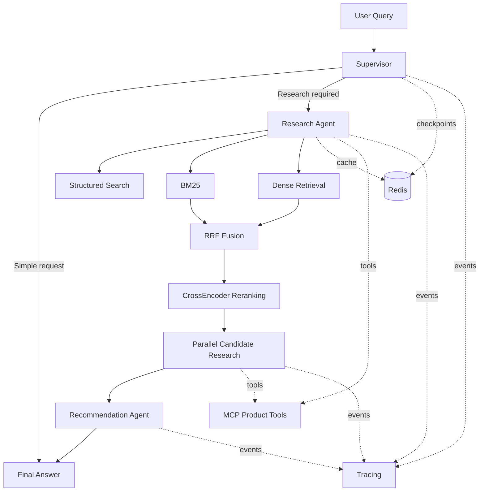

# Multi-Agent Shopping Copilot

[](https://github.com/JinSiyi22/shopping-agent/actions/workflows/tests.yml)

A production-oriented **multi-agent product research and recommendation system** built with FastAPI, LangGraph, hybrid retrieval, CrossEncoder reranking, Redis, MCP, observability, and Docker.

It turns complex shopping requirements into a structured research workflow:

```text
User Query
    ↓
Supervisor
    ↓
Hybrid Retrieval
    ↓
CrossEncoder Reranking
    ↓
Candidate Research
    ↓
Grounded Recommendation
```

The project focuses not only on generating recommendations, but on making the whole pipeline **retrievable, testable, inspectable, and reproducible**.

---

## Highlights

- Multi-Agent orchestration with **Supervisor → Research → Candidate Research → Recommendation**
- Hybrid retrieval with **BM25 + Dense Retrieval + RRF + CrossEncoder**
- Structured tool calling for search, detail lookup, comparison, and research
- Redis-backed sessions, LangGraph checkpoints, and tool-result caching
- MCP-based product tool execution
- LLM provider abstraction with retry, quota classification, token accounting, and optional cost estimation
- Real-catalog evaluation with frozen held-out scenarios
- Streamlit live demo and recorded trace replay
- Docker Compose deployment for **Redis + FastAPI + Streamlit**
- **104 automated tests**

---

## Architecture



The design separates:

- orchestration from LLM runtime,
- retrieval from generation,
- tool evidence from final recommendations,
- live execution from offline evaluation and replay.

---

## How It Works

### 1. Supervisor Routing

The Supervisor determines whether the request needs:

- direct product lookup,
- structured filtering,
- comparison,
- semantic retrieval,
- or full candidate research.

Simple tasks can bypass expensive research stages.

### 2. Hybrid Retrieval

The retrieval pipeline combines lexical and semantic signals:

```text
BM25 ─────┐
          ├── RRF ──→ CrossEncoder ──→ Top Candidates
Dense ────┘
```

BM25 is strong for exact names, brands, model numbers, and explicit terms.

Dense retrieval improves semantic recall when user wording differs from catalog wording.

RRF combines both candidate lists before CrossEncoder reranking.

Recommended embedding configuration:

```text
EMBEDDING_MODEL_NAME=intfloat/multilingual-e5-small
EMBEDDING_QUERY_PREFIX=query:
EMBEDDING_DOCUMENT_PREFIX=passage:
```

Reranker:

```text
BAAI/bge-reranker-base
```

### 3. Candidate Research

The Agent can research top candidates through structured tools and product evidence.

Parallelism is intentionally bounded to avoid unnecessary TPM pressure and latency growth.

### 4. Recommendation

The final Agent receives candidate evidence and produces a recommendation grounded in retrieved catalog products.

---

## Retrieval Evaluation

The primary retrieval benchmark uses **WANDS**.

Dataset setup:

```text
42,994 products
480 queries
96 development queries
384 held-out test queries
```

Retrieval depth and reranking configuration were selected on the development split before final held-out evaluation.

### Held-Out Results

| Method | nDCG@10 | MRR | Exact Recall@50 |
|---|---:|---:|---:|
| BM25 | 0.6845 | 0.7017 | 0.5185 |
| Dense | 0.7130 | 0.7135 | 0.5172 |
| RRF | 0.7388 | 0.7240 | 0.5552 |
| Dense → CrossEncoder@20 | 0.7482 | 0.7609 | 0.5172 |
| **RRF → CrossEncoder@20** | **0.7662** | **0.7598** | **0.5552** |

The final retrieval stack uses:

```text
BM25 + Dense
      ↓
     RRF
      ↓
CrossEncoder@20
```

Detailed benchmark artifacts are stored in:

```text
reports/
```

---

## Agent-Level Evaluation

The final Agent benchmark covers:

- structured hard-filter requests,
- semantic recommendations,
- product-detail queries,
- product comparison,
- multi-turn context reuse,
- new constraints introduced during conversation.

### Strict Held-Out Split

```text
30 unseen scenarios
36 total turns
```

### Results

| Metric | Result |
|---|---:|
| Routing accuracy | **100%** |
| Tool-selection accuracy | **100%** |
| Hard-constraint pass rate | **100%** |
| Semantic Hit@K | **100%** |
| Expected-product coverage | **100%** |
| Answer expected-product coverage | **100%** |
| Catalog-product grounding | **100%** |
| Evidence-product mention rate | **91.67%** |
| Automatic task success | **97.22% (35/36)** |
| Scenario success | **96.67% (29/30)** |
| Average latency | **34.73 s** |
| Median latency | **39.08 s** |

The frozen automatic result remains:

```text
35 / 36 successful turns
```

A post-hoc manual audit found that the only automatic failure was caused by an evaluator alias-resolution mismatch rather than an incorrect recommendation.

Manual audit result:

```text
36 / 36 turns acceptable
```

This manual result is reported separately and does **not** replace the frozen automatic score.

Relevant artifacts:

```text
reports/agent_eval_real_heldout_final.json
reports/agent_eval_real_strict_heldout_summary.json
reports/agent_eval_real_strict_heldout_audit.json
```

### Evaluation Scope

`catalog-product grounding` means that identifiable products mentioned in the answer correspond to retrieved catalog evidence.

It does **not** imply that every generated product attribute has been independently fact-checked.

Some semantic-relevance labels are proxy labels derived from catalog/tag consistency rather than full human relevance annotation.

---

## Runtime Engineering

### LLM Runtime

LLM access is isolated under:

```text
app/llm/
├── provider.py
├── errors.py
└── usage.py
```

The runtime handles:

- shared OpenAI-compatible client construction,
- model defaults,
- timeout and connection retry,
- rate-limit classification,
- token accounting,
- optional cost estimation.

Transient limits such as TPM/RPM are retried.

Daily quota failures such as TPD/RPD fail fast instead of repeatedly sleeping and retrying.

Optional cost configuration:

```text
LLM_INPUT_COST_PER_1M
LLM_OUTPUT_COST_PER_1M
```

Provider prices are not hard-coded.

### Redis

Redis is used for:

```text
Session registry
LangGraph checkpoints
Tool-result cache
```

Main TTL settings:

```text
CHECKPOINT_TTL_MINUTES
SESSION_TTL_SECONDS
TOOL_CACHE_TTL_SECONDS
```

### MCP

Product tools are exposed through an MCP server and consumed by the Agent runtime.

This keeps product operations separate from orchestration and LLM logic.

---

## Demo

The repository includes a Streamlit portfolio demo under:

```text
demo/
```

It supports two useful modes.

### Live Mode

Runs against the real FastAPI Agent backend.

Requires:

- Redis,
- FastAPI,
- a valid LLM provider API key.

### Replay Mode

Replays recorded real Agent traces.

It:

- does not call the LLM,
- does not consume provider quota,
- keeps interview demos reproducible,
- shows real execution events and latency information.

This provides a stable fallback when an external provider is unavailable or rate-limited.

---

## Quick Start with Docker

The application is deployed as three services:

```text
Browser
   ↓
Streamlit Demo :8501
   ↓
FastAPI Agent :8000
   ↓
Redis :6379
```

Clone the repository:

```bash
git clone https://github.com/JinSiyi22/shopping-agent.git
cd shopping-agent
```

Create configuration:

```bash
cp .env.example .env
```

Fill in at least:

```text
LLM_API_KEY=
LLM_BASE_URL=
LLM_MODEL=
```

Start the stack:

```bash
docker compose up -d --build
```

Check status:

```bash
docker compose ps
```

Health check:

```bash
curl http://127.0.0.1:8000/health
```

Open:

```text
FastAPI Swagger:
http://127.0.0.1:8000/docs

Streamlit Demo:
http://127.0.0.1:8501
```

Stop:

```bash
docker compose down
```

Container-to-container addresses:

```text
Demo → API
http://api:8000

API → Redis
redis://redis:6379/0
```

The API Docker image uses **CPU-only PyTorch** rather than copying the local CUDA development environment into the runtime image.

---

## Local Development

Create the environment:

```bash
python3 -m venv .venv
source .venv/bin/activate
pip install -r requirements.txt
```

Create configuration:

```bash
cp .env.example .env
```

Start the API:

```bash
PYTHONPATH=. uvicorn app.api.main:app --reload
```

Run the demo:

```bash
pip install -r demo/requirements.txt
streamlit run demo/app.py
```

---

## Testing

Run the full test suite:

```bash
PYTHONPATH=. python -m pytest tests -q
```

Current result:

```text
104 passed
```

Tests cover:

- product search,
- hybrid retrieval,
- reranking,
- tools,
- Redis cache and sessions,
- API behavior,
- Multi-Agent orchestration,
- LLM provider handling,
- WANDS evaluation,
- real Agent evaluation.

---

## Project Structure

```text
shopping-agent/
├── app/
│   ├── agents/           # Agent orchestration
│   ├── api/              # FastAPI service
│   ├── data/             # Dataset adapters
│   ├── evaluation/       # Evaluation logic
│   ├── infrastructure/   # Redis infrastructure
│   ├── llm/              # LLM provider and observability
│   ├── mcp/              # MCP client/server
│   ├── memory/           # Session state
│   ├── models/           # Pydantic models
│   ├── observability/    # Logging and traces
│   ├── services/         # Retrieval and ranking
│   └── tools/            # Agent tools
│
├── data/                 # Product catalogs
├── demo/                 # Streamlit live/replay demo
├── evals/                # Evaluation definitions
├── reports/              # Frozen benchmark artifacts
├── scripts/              # Development/evaluation scripts
├── tests/                # Automated tests
│
├── Dockerfile
├── compose.yaml
├── requirements.txt
├── requirements-runtime.txt
└── .env.example
```

---

## Engineering Decisions

Several implementation choices were driven by observed runtime or evaluation behavior:

- **Hybrid retrieval over dense-only retrieval**  
  WANDS evaluation showed complementary lexical and semantic recall.

- **RRF before CrossEncoder reranking**  
  RRF improves candidate recall while the CrossEncoder improves final ranking quality.

- **Bounded parallel candidate research**  
  Uncontrolled parallel LLM calls increase TPM pressure and latency without proportional quality gains.

- **Task-dependent routing**  
  Simple detail and comparison requests can bypass unnecessary research stages.

- **TPM retry vs. TPD fail-fast**  
  Temporary rate limits and exhausted daily quotas require different recovery strategies.

- **Replayable traces**  
  Recorded traces make the portfolio demo reliable even when the external LLM provider is unavailable.

---

## Limitations

Current limitations include:

- the runtime catalog contains about 1,000 real Amazon-derived products rather than a production-scale commerce catalog;
- catalog-product grounding does not guarantee attribute-level factuality;
- some semantic relevance labels are proxy labels rather than full human annotations;
- WANDS judgments are pooled and non-exhaustive;
- live latency depends heavily on the external LLM provider;
- per-session request locks are process-local rather than distributed;
- the Docker image currently prioritizes reproducibility over minimum image size.

---

## Repository

```text
https://github.com/JinSiyi22/shopping-agent
```